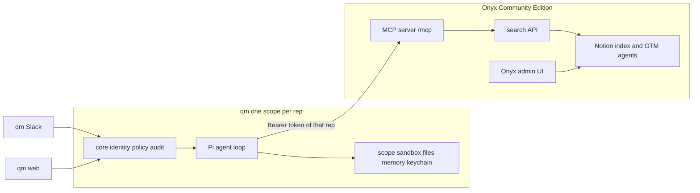

# Onyx and qm

qm is the per-rep front door. This Onyx fork is the headless GTM brain. qm calls Onyx over the MCP server. Reps do not use the Onyx chat UI.

qm stays in its own deployment repository. This folder does not vendor qm. The notes below were read from [yc-software/qm](https://github.com/yc-software/qm) commit `f357718980410ae72147f48529154da3a73a38cf` (2026-10-31) and from this Onyx tree. Nothing here was run against a live qm or a live Onyx MCP server.

## Architecture



| Person | Surface |
| --- | --- |
| SDR, AE, CS, manager | qm Slack and the qm web app. Each person has their own sessions, memory, files, keychain, and sandbox. |
| RevOps operator | qm for drafts. Onyx admin UI to connect Notion, run `gtm/config/bootstrap.py`, and manage agents. |
| The agent | Pi inside qm. It searches Onyx. It does not send mail or write a CRM record. |

A shared channel is a different qm scope from a person's private scope. Keep sharing posture Isolated until a human policy says otherwise. Isolated is qm's default (`HARNESS_SHARING_POSTURE` unset). Verified in `src/config.ts` at the commit above.

## What Onyx MCP actually does

The bundled compose stack runs `mcp_server` and nginx publishes it at `/mcp` (`deployment/data/nginx/mcp.conf.inc.template`). Customer docs say the server is on for every edition, including Community Edition (`documentation/overview/onyx_anywhere/mcp_server.mdx`).

Tools in `backend/onyx/mcp_server/tools/search.py`. `search_web` and `open_urls` register only when `MCP_INDEXED_SEARCH_ONLY` is not `true`:

| Tool | Effect |
| --- | --- |
| `search_indexed_documents` | Search the index. Optional `agent` uses that agent's document sets and model. |
| `search_web` | Public web search, if Onyx web search is configured. |
| `open_urls` | Fetch public page text. |

qm namespaces a non-catalog server as `<serverId>_<toolName>` (`src/mcp/mcp-tool-service.ts`). With server id `onyx` the indexed tool is `onyx_search_indexed_documents`. That string was not observed from a live `tools/list`.

`agent` does not start an Onyx chat. The customer doc says the search uses the agent's knowledge scope and does not run that agent's prompt. The citation rule, the fallback sentence, and "a human sends" live in the qm skill `sandbox/skills/gtm/SKILL.md`. There is no MCP tool for `POST /chat/send-chat-message`.

Do not pass `agent` and `document_set_names` together. The tool returns an error. Verified in `_resolve_filters`.

## Auth and identity

Onyx MCP auth is `OnyxTokenVerifier` in `backend/onyx/mcp_server/auth.py`.

| Bearer | How Onyx treats it |
| --- | --- |
| Personal access token `onyx_pat_...` | `GET /me` as that user. `read:search` is a Community-tier PAT scope (`backend/onyx/server/pat/models.py`). |
| API key `on_...` | `GET /me` as the user who owns the key. An admin key searches as the admin. |
| OAuth access token `onyx_oat_...` | Introspection. The token carries `subject`. Self-hosted OAuth needs HTTPS. Not tested with qm. |
| qm header `x-qm-actor` | Ignored. Onyx does not read it. |

qm per-user MCP (`docs/mcp-connectors.md`, `callerClient` in `mcp-tool-service.ts`):

- Discovery (`tools/list`) uses the shared `bearerToken`.
- Each `tools/call` uses the initiating person's token from the keychain at `credentialHost`.
- `attestActor` is not sent when `credentialScope` is `per-user`. The header path requires shared credentials. A shared token plus `x-qm-actor` would still search as the shared Onyx user.

Use per-user tokens. Do not point every rep at one admin API key.

Map a person by email yourself. qm's principal id (`jordan@acme.test`, a Slack id, or `oidc:...`) is not an Onyx user id. Principal links fold several qm sign-ins into one canonical id (`docs/principal-links.md`). They do not create an Onyx user. Store that canonical principal's Onyx PAT with `POST /v1/connectors/token` and `host` equal to `credentialHost`. That endpoint was not called here.

On Community Edition the Hub document sets are public, so every signed-in user can be offered those pages. That does not mean every page is visible. A document's readers are the owners of its PRIVATE connector credentials, plus everyone if any pair on that document is PUBLIC (`onyx/db/document.py`, `onyx/access/access.py`). MCP `search_indexed_documents` calls `/search` with the caller's bearer, and that search applies the ACL. Groups and synced permissions (`SYNC`, `SYNC_RESTRICTED`) are the paid path. PRIVATE with no groups is Community Edition. This fork uses that for Informatics: one private pair per viewer, and the Hub crawl excludes the Informatics page so those documents are not also PUBLIC.

Onyx Cloud charges for access tokens. This deployment is self-hosted. The cloud rule does not apply here. Verified as a docs statement, not as a cloud trial.

## Security posture

Set qm `HARNESS_SECURITY_POSTURE` to `strict`. The stub does that in `layer/qm.config.jsonc`. Strict sets tool approvals to all (`src/security/security-posture.ts`). The turn gate asks for a consumed approval before a tool runs (`toolApprovalGate` in `src/core/orchestrator.ts`). `mcp_call` delegates to that gated tool (`src/agent/agent-tools/mcp.ts`). `tool_search` is exempt. A live approval card was not clicked in this work.

The Onyx registration sets `readOnly: true` and `approval: "all"`. `approval: "all"` makes every Onyx tool pause even if the org posture is later loosened to Auto (`mcpToolNeedsApproval`). Strict already pauses them. `approval: "none"` does not override Strict. The gate still runs when the tool itself does not declare `needsApproval`.

Decided for v1: MCP_INDEXED_SEARCH_ONLY=true on the GTM VM. The server does not register search_web or open_urls. The default stays off.

Anything that sends or writes (Slack send, a future CRM tool) stays under Strict. Do not add those tools to the Onyx agents. Onyx stays answer-and-draft.

qm refuses MCP URLs that resolve to loopback, link-local, private, or unspecified addresses (`docs/mcp-connectors.md`). A private Onyx URL may not register. Plan on a public HTTPS origin for `/mcp`. This refusal was not re-tested.

## Configure qm. Do not fork it.

Configure in the qm deployment repository:

| Piece | Where |
| --- | --- |
| Directory | `qm init` in its own repo. Pin `@yc-software/qm`. Do not copy this stub over an init that check already accepted. |
| Posture | `HARNESS_SECURITY_POSTURE=strict` |
| Model | `modelProvider: "openai"`. The key is a qm secret, not a config value. |
| Surfaces | `web-ui`, `portal`, `admin`, `auth`, `slack`. Admin and auth fold into web-ui and portal (`docs/combined-services.md`). |
| Skill | `sandbox/skills/gtm/` from this stub. |
| Onyx MCP | `PUT /v1/admin/mcp-servers/onyx` with `layer/mcp/onyx-mcp-server.json` plus a discovery `bearerToken`. |
| Per-rep tokens | `CONNECTOR_SECRET_KEY` plus `POST /v1/connectors/token`. |
| Same person on Slack and web | qm principal links. Separate from Onyx accounts. |

Fork qm only for a behavior the deployment directory cannot express. Honoring `x-qm-actor` inside Onyx would be a change in this fork, and it would be a core edit. Do not do that for the first deployment. Per-user PATs already select the Onyx user.

Do not commit qm source, qm images, or `.env` into this Onyx repo.

## Onboard an Informatics viewer

Informatics is page `408233ce-1c17-81e4-a92f-e23cc8bb95fd`. The viewers are Kevin Williams, Garrick Iwamoto, Ian Chand, and Jessica Xu (`jessica.xu@pushpress.com`).

Use a **new** read-only Notion internal integration. Capability: read content only. Do not use the existing `RevOps | Dev` integration. The Hub connector's `NOTION_INTEGRATION_TOKEN` is that new token. Each viewer uses the same integration when they create their own Onyx credential.

Onyx Community Edition only lets an admin create a credential, and there is no change-owner API. The credential owner is the user who calls `POST /api/manage/credential`.

1. Confirm the person has signed in to Onyx with their `pushpress.com` Google account.
2. Promote them to admin.
3. They create the credential themselves, with `admin_public: true`, so the bootstrap admin can see it and pair it:

```json
{
  "name": "Informatics",
  "source": "notion",
  "admin_public": true,
  "credential_json": {"notion_integration_token": "<their token>"}
}
```

4. Demote them.
5. Run `python3 gtm/config/bootstrap.py`. It pairs that credential to the Informatics connector with `access_type: private` and `groups: []`.

To remove a viewer, delete their email from `viewers` in `gtm/config/gtm.yaml` and from the Informatics agent's `viewer_emails`. Re-run the bootstrap. It deletes that credential's pair. Their token then fails the document ACL. Also revoke the Onyx personal access token stored in qm.

Start the Hub index fresh after `excluded_page_ids` is set, or confirm Informatics documents are no longer PUBLIC. Pages indexed by an earlier public crawl can stay readable until that check. Pruning of those pages was not verified here.

## Open questions

1. Will qm accept this Onyx origin, or will the private-address check reject the host you actually deploy?
2. Does qm `oauth-user` complete against Onyx's OAuth server (PKCE, dynamic client registration, scope `read:search`)? Not tried. PATs are the path this stub uses.
3. Who creates the Onyx user and the PAT for each rep, and how is a revoked rep removed from both systems?
4. Should a later MCP tool expose `POST /chat/send-chat-message` so the Onyx harness prompt runs inside Onyx? Today the skill repeats those rules.
5. Decided for v1: MCP_INDEXED_SEARCH_ONLY=true on the GTM VM. The server does not register search_web or open_urls. The default stays off.
6. After Notion indexes, do you attach hierarchy nodes per role so search scope is narrower than the public document set? Community Edition cannot do that with groups.

## Unverified

- `qm check`, `qm doctor`, `qm plan`, and `qm up` were not run.
- No live `tools/list` or `tools/call`.
- No admin session and no connector-token write.
- The service list in `qm.config.jsonc` matches the names in `cli/src/services.ts` and `docs/combined-services.md`. A newer qm may still reject the combination.
- CLI package version in the clone's `cli/package.json` was `0.1.6`. This stub does not pin npm. The deployment repo pins the version `qm init` writes.
